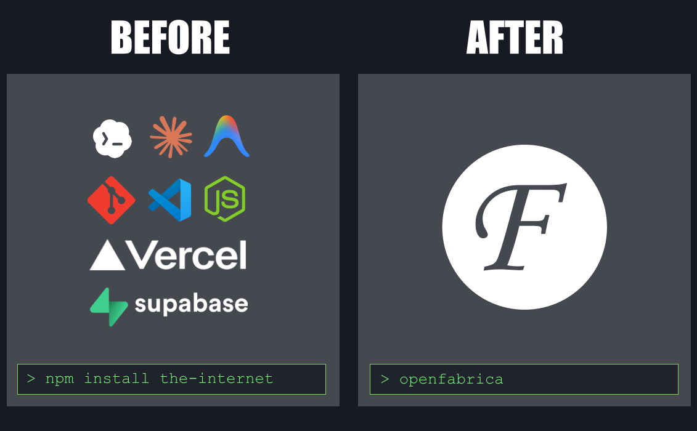
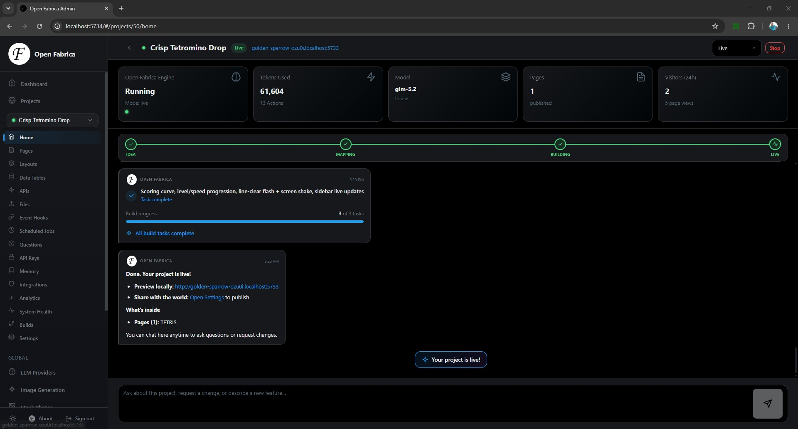
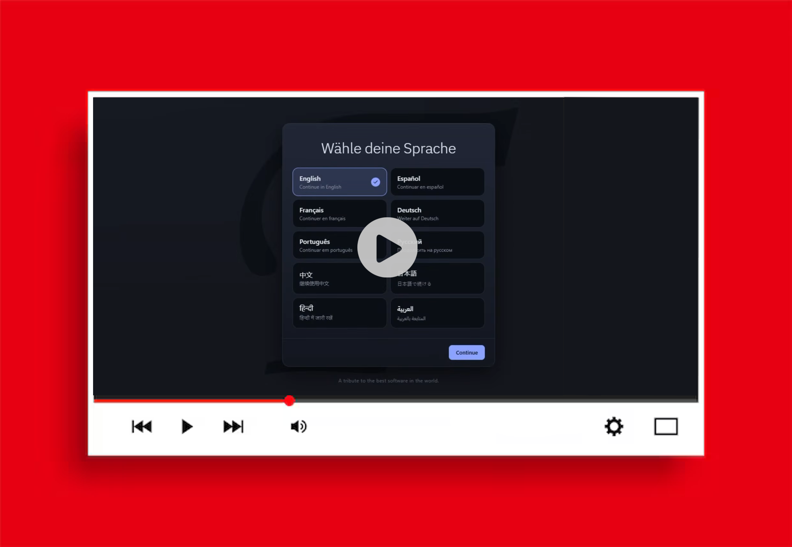
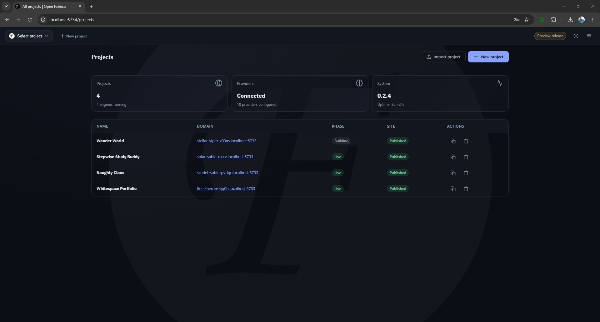
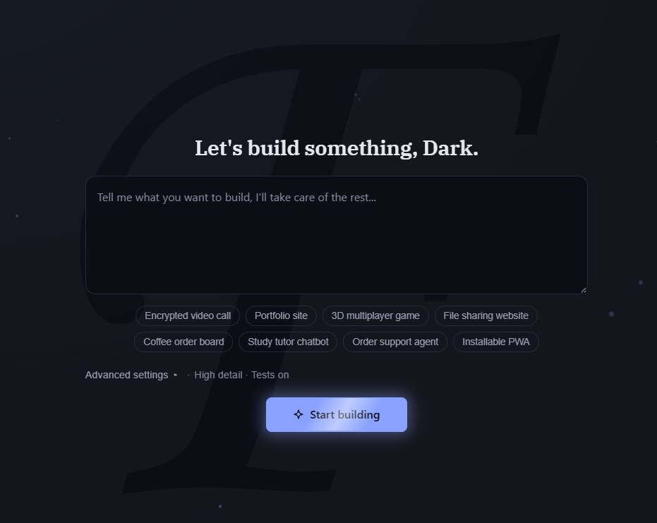

[](https://github.com/dark-rumlinger/open-fabrica/releases)
[](https://github.com/dark-rumlinger/open-fabrica/actions/workflows/ci.yml)
[](https://github.com/dark-rumlinger/open-fabrica/releases)
[](go.mod)
[](LICENSE)
[](https://github.com/dark-rumlinger/open-fabrica/releases)
[](https://github.com/dark-rumlinger/open-fabrica/releases)
[](https://github.com/dark-rumlinger/open-fabrica/releases)
[](https://github.com/dark-rumlinger/open-fabrica/releases)
[](https://x.com/open_fabrica)

# Open Fabrica: I'll be whatever you want me to be

**Build ANYTHING you dream of with one (literally) click. Instantly served to the world from your own machine. 100% private.**

Forget everything you think you know about software, developing, hosting, databases, APIs, or a certain "tech stack". **Open Fabrica IS the stack.** All in one single, portable file.

You'll learn to love and understand her better as you go.

## Ideas are Everywhere

Open Fabrica is meant for everyone. Literally. From school kids to teachers, from shop owners to scientists and home-lab tinkerers. Everyone has amazing ideas, and now there are no more technical or financial hurdles to overcome. It just works.

Bring your own AI key or run a free local model on your own machine, and start building, one idea at a time.

| | Cloud AI App Builders | Open Fabrica |
|---|---|---|
| **Cost** | Monthly subscriptions + hosting fees | **Forever free**: bring your own AI key or run local models |
| **Privacy** | Your app & data live on someone else's servers | **100% on your own machine**: zero sign-up, zero phone-home |
| **Reliability** | Hands you generated code and hopes it works | **Tests your app in a real browser**, clicks every button on desktop & phone, and fixes bugs itself |
| **Going live** | Separate hosting, databases, and DNS headaches | **Built-in hosting & automatic HTTPS**: plus guided firewall & router setup |
| **Your home & devices** | Trapped in the cloud | **Talks directly to your local network**, smart-home sensors, cameras, PCs, and Raspberry Pis |

## What Can I Build?

**Anything** that runs in a browser, from a weekend idea to a real business or your own smart-home hub:

- **Smart-home & home-lab dashboards**: connect to your existing Zigbee, ESPHome, Shelly, Frigate cameras, or DIY sensors, get alerts if a sensor goes silent, and wake your sleeping PC or NAS with one click
- **Online stores & SaaS apps**: user accounts, Stripe/PayPal/Mollie payments, automatic PDF invoices, and built-in analytics
- **AI assistants & support desks**: smart helpers that read your app's own data, take multi-step actions, and answer customers in plain language
- **Real-time apps for shops & teams**: live coffee-shop order boards, booking systems, and collaborative tools that work offline as installable phone apps (PWAs)
- **Private communication apps**: end-to-end encrypted text, audio, and video calling with file sharing
- **2D & 3D multiplayer games**: real-time rooms and server-side game logic out of the box

*Just give her your wildest ideas and she'll figure it out.*



## Quick Start

1. **Download** from [Releases](https://github.com/dark-rumlinger/open-fabrica/releases).
2. **Run**: double-click the file, or run `./openfabrica` in your terminal.
3. **Describe your idea**: she plans, builds, tests, and launches it for you. Sit back and relax.

*The video below guides you through the 1-minute setup process:*

[](https://www.youtube.com/watch?v=n17afF0SnDo)

---

## What's Built In

Everything below ships inside the single binary: no Docker, no external database, no third-party broker, no glue code.

### 1. Autonomous Build & Self-Repair Engine
- **Plans, builds, and verifies automatically:** turns a plain-English idea into a real full-stack app (pages, SQLite database, APIs, server functions, background jobs, and realtime rooms).
- **Real-browser testing:** boots your finished app in headless Chrome, clicks every control on desktop and mobile layouts, checks for console/network errors and WebSocket health, and **self-repairs** issues before going live.
- **Telegram bot control:** plan and build projects, answer the builder's questions, watch live progress cards, and inspect every LLM call from your phone (2-minute QR-code setup, no user IDs to look up).
- **Unlimited projects & instant portability:** run as many apps as you want from one instance, duplicate in one click, or export/import any project as a single `.of` file.

### 2. Local-First Smart Home, IoT & Home-Lab Superpowers
- **Built-in MQTT 3.1.1 broker** (WebSocket `/mqtt` + optional raw TCP via `OPENFABRICA_MQTT_PORT`) with per-device credentials & topic ACLs, scoped JWT browser ACLs (`{user_id}` / `{tenant_id}`), persisted retained messages, and Last Will & Testament (LWT).
- **Outbound LAN MQTT Bridges:** plug directly into your existing LAN broker (Mosquitto, **Zigbee2MQTT**, **ESPHome**, **Shelly**, **Frigate NVR**, **Tasmota**, **Meshtastic**) over `tcp://` or `tls://` with built-in loop prevention, prefix remapping, encrypted passwords, and automatic reconnect, with zero device re-flashing.
- **Smart Time-Series Ingest & Rollups:** named topic captures (`sensors/{zone}/{metric}`, `zigbee2mqtt/{device}`), schema-aware JSON & scalar SQLite inserts, per-topic insert throttling, automatic retention pruning (`retention_days`), and O(1) streaming rollups (`1m` / `5m` / `15m` / `1h` / `1d`) queryable at `GET /api/__mqtt/rollups`.
- **Dead-Man's-Switch Watchdogs & Sleepy Devices:** optional per-device `heartbeat_sec` fires `mqtt.device_stale` once if a sensor goes silent (and `mqtt.device_recovered` when it returns); full `cleanSession=false` persistent sessions & bounded offline command queues deliver queued commands to battery-powered ESP32s when they wake from deep sleep.
- **Admin Studio MQTT Inspector:** live SSE topic stream, test publisher, device token generator, and bridge health dashboard built right into the Admin UI.
- **Pure-Go LAN Toolkit (`manage_lan` & `ctx.lan`):** **Wake-on-LAN** magic packets (`ctx.lan.wake(mac)`), private-LAN TCP reachability pings (`ctx.lan.ping(host, port)`), and **mDNS/Bonjour** service discovery (`manage_lan discover`), strictly scoped to your private LAN and `.local` hosts.

### 3. Built-In AI & Multi-Step Agents
- **AI agents with sub-agents:** hosted endpoints that reason, call your app's own functions, query its data in a loop, and spawn sub-agents for larger tasks, streaming live or running in the background.
- **Per-project AI assistants & hooks:** configurable personality and memory, plus server-side AI hooks to auto-summarize, classify, or embed new database rows on insert.
- **Keyword & semantic search:** full-text search out of the box, plus vector semantic search when an embeddings provider is configured.
- **Media built in:** image generation via OpenAI or local Stable Diffusion (Automatic1111), plus automatic stock photos from Pexels, Pixabay, and Unsplash.
- **Hard AI spend ceilings:** separate daily token budgets for unattended builds/jobs (5M/day default) vs. visitor-facing chatbots/agents (1M/day default), plus per-project dollar caps.

### 4. Real-Time, Multiplayer & Offline-Ready
- **Real-time rooms, live feeds, and authoritative multiplayer:** WebSocket rooms, server-side JS game reducers, P2P audio/video calling, and file uploads, with optional end-to-end encryption (E2EE).
- **Web Push & in-app notifications:** auto-managed VAPID keys plus a per-user notification inbox (list, unread count, mark read).
- **Installable PWAs:** offline support, manifests, and home-screen icons out of the box.

### 5. Accounts, Payments & Business Ready
- **Auth & access control:** email/password logins, optional Google/GitHub (or any OAuth2) social login, TOTP 2FA, passwordless magic links, row-level security, multi-tenancy, and role-based permissions.
- **Payments:** Stripe, PayPal, and Mollie (one-off on all three; recurring subscriptions, refunds, and automatic signed-webhook reconciliation on Stripe).
- **Documents, data & automation:** HTML-to-PDF invoices/receipts/reports (via local Chromium), email (SendGrid, Mailgun, Resend, or custom JSON endpoint), CSV import/export, RSS/Atom feeds, auto-generated REST APIs with docs & rate limiting, cron/interval scheduled jobs, and event-driven triggers.
- **Local analytics & SEO:** privacy-friendly local visitor & AI-cost analytics, plus automatic Open Graph, JSON-LD, sitemaps, and `robots.txt`.



## Free, Private and Portable

- **Forever Free.** No sign-up, no subscription, no per-project fee. Download the binary and run it.
- **No phone-home.** No usage or error reporting, no analytics SDK, no "check for updates" call. The admin panel is fully self-contained (every script, style, and font is served from the binary), so it works fully offline.
- **Local First.** One binary, your data, your machine. The only time anything leaves your machine is when *you* trigger it.
- **Bring your own key.** Use your own Anthropic, OpenAI, Google Gemini, OpenRouter, or Z.ai key, or run fully offline models with Ollama or llama.cpp.
- **Portable.** Copy the binary and your `data/` folder to any Windows, macOS, or Linux box and it picks up where it left off, or use `openfabrica backup` / `openfabrica restore` for a single-file live backup. To remove an installation completely, send `/selfdestruct` to the Telegram bot (two confirmations); `openfabrica selfdestruct --dry-run` previews what it would erase. See [SECURITY.md](docs/SECURITY.md) for its limits.



## Before You Go Live

If you only run locally, the Quick Start is all you need. If you expose generated apps to the internet or enable payments, do these first:

- **Back up your encryption key with your data.** `data/.security/encryption.key` decrypts every stored secret (API keys, OAuth tokens, payment credentials, bridge passwords, TOTP seeds). Lose it and those are unrecoverable. Back it up *together with* the `data/` folder.
- **Review your AI spend ceiling.** Unattended AI (builds, event triggers, scheduled jobs, server functions) shares a safe 5M-token-per-project-per-day ceiling **on by default** (visitor-facing AI chat/agents draw on a separate 1M/day pool). Adjust both pools or set a daily dollar cap in **Project → Settings → Advanced → Daily AI limits**, or set `OPENFABRICA_ENGINE_DAILY_TOKEN_BUDGET=0` for unlimited.
- **Isolate untrusted/multi-user apps.** Serve each project on its **own domain/subdomain** so one app can't reach another's same-origin storage, and tighten CSP via `OPENFABRICA_PUBLIC_CSP=hardened` or per project in **Project → Settings → Advanced**.
- **Cap memory for untrusted apps.** Set a soft ceiling with `OPENFABRICA_MEMORY_LIMIT` (e.g. `1GiB`, or `512MiB` on 1 GB Raspberry Pi boards) and pair with a container/systemd hard memory limit + auto-restart (see [`Dockerfile`](Dockerfile) and [`deploy/openfabrica.service`](deploy/openfabrica.service)).
- **Keep the admin panel on localhost** (the default). See **Security** below.

Health probes on either port (bypass auth and routing): `GET /health` (`/healthz`) for liveness (`200 ok`), and `GET /ready` (`/readyz`) for readiness (`200 ready` / `503 unavailable`).

## Self-Hosting and HTTPS

Point your domain's DNS at your server, open ports 80 and 443, then add the domain to a project (**Project → Settings → General → Domain**). HTTPS goes live on demand via Let's Encrypt in ~30 seconds with no restart. If another web server already owns `:80/:443`, set `OPENFABRICA_TLS_DISABLED=1`.

When you set a public domain, the admin UI guides you through every remaining step, with one click wherever a machine can do it:

- **Allow through firewall** (UAC on Windows, admin prompt on macOS, polkit on Linux).
- **Open ports on your router** automatically via UPnP / NAT-PMP / PCP (only `:80` and `:443`, only while running; manual instructions if your router refuses).
- **Exact DNS record to add** with your public IP fetched locally from your router (never an external IP service), plus carrier-grade NAT detection and IP-change alerts.

## Security by Default

- **Loopback-only control plane:** The admin panel runs on port **5734** bound to `127.0.0.1` by default. Reach it remotely over SSH:
  ```bash
  ssh -L 5734:localhost:5734 user@yourserver
  ```
  Exposing it on a network interface requires setting **both** `OPENFABRICA_ADMIN_BIND` and `OPENFABRICA_ADMIN_EXPOSE=1`; an uninitialized exposed instance prints a one-time `setup_token` so nobody else can claim it first. The public project server on port **5733** is always network-reachable.
- **Defense in depth:** Per-IP rate limiting, per-account login lockout with escalating backoff, immediate JWT revocation on password change, encrypted secrets & `PASSWORD`/`ENCRYPTED` column protection, row-level security (RLS), SSRF & cloud-metadata blocking (`169.254.169.254`), and sandboxed JS server functions. See [SECURITY.md](docs/SECURITY.md).

## Configuration

Zero-config by default. Most users never need to touch a setting; when you do, use `config.json` or environment variables:

| Variable | Default | What it does |
|---|---|---|
| `OPENFABRICA_ADMIN_PORT` | 5734 | Port for the admin panel |
| `OPENFABRICA_PUBLIC_PORT` | 5733 | Port where your projects are served |
| `OPENFABRICA_MQTT_PORT` | 0 (WS `/mqtt` only) | Optional raw TCP port for the built-in MQTT broker (e.g. `1883` for ESP32/embedded devices) |
| `OPENFABRICA_DATA_DIR` | ./data | Where project databases and files are stored |
| `OPENFABRICA_ENGINE_DAILY_TOKEN_BUDGET` | 5000000 | Daily cost-weighted token ceiling per project for unattended builds/jobs (`0` = unlimited) |
| `OPENFABRICA_MEMORY_LIMIT` | | Soft Go heap ceiling (e.g. `1GiB`, `512MiB` on Raspberry Pi) |

<details>
<summary>All environment variables & advanced options</summary>

| Variable | Default | What it does |
|---|---|---|
| `OPENFABRICA_ADMIN_BIND` | 127.0.0.1 | Interface the admin panel binds to (loopback by default) |
| `OPENFABRICA_ADMIN_EXPOSE` | | Set to `1` to allow binding admin to a non-loopback address |
| `OPENFABRICA_DB_PATH` | `<data_dir>/openfabrica.db` | Path to the core SQLite database |
| `OPENFABRICA_SEED_PATH` | ./seed.json | Provider seed applied on every start (embedded copy used when missing) |
| `OPENFABRICA_JWT_SECRET` | auto-generated | JWT signing key (min 32 chars) |
| `OPENFABRICA_ENCRYPTION_KEY` | auto-generated | At-rest encryption key (64 hex chars) |
| `OPENFABRICA_ALLOW_KEY_REGEN` | | Set to `1` to allow regenerating missing `jwt.key`/`encryption.key` on a populated DB (invalidates sessions / makes encrypted secrets unreadable) |
| `OPENFABRICA_TLS_DISABLED` | false | Skip binding `:80`/`:443` (use when another web server owns those ports) |
| `OPENFABRICA_TLS_STAGING` | false | Use Let's Encrypt staging CA while testing |
| `OPENFABRICA_LOG_LEVEL` | info | `debug`, `info`, `warn`, `error` |
| `OPENFABRICA_LOG_FILE` | | Also write rotating logs (20 MB, 5 files kept) to this file |
| `OPENFABRICA_TRUSTED_PROXIES` | | Comma-separated reverse-proxy IPs/CIDRs so rate limits see real client IPs |
| `OPENFABRICA_RATE_LIMIT_RATE` | 100 | Requests per second per IP |
| `OPENFABRICA_RATE_LIMIT_BURST` | 200 | Burst allowance above the rate |
| `OPENFABRICA_LLM_TIMEOUT` | 900 | Per-LLM-call deadline in seconds |
| `OPENFABRICA_ENGINE_STAGE_EXPAND_TIMEOUT_MIN` | 5 | Wall-clock timeout (minutes) for EXPAND |
| `OPENFABRICA_ENGINE_STAGE_PLAN_TIMEOUT_MIN` | 30 | Wall-clock timeout (minutes) for PLAN |
| `OPENFABRICA_ENGINE_STAGE_BUILD_TIMEOUT_MIN` | 90 | Wall-clock timeout (minutes) for BUILD |
| `OPENFABRICA_PUBLIC_CSP` | (permissive) | Override public CSP; supports `{nonce}`, `hardened` preset, or empty string |
| `OPENFABRICA_NO_BROWSER` | | Set to `1` to suppress auto-opening the admin URL on startup |
| `OPENFABRICA_CHROME_PATH` | auto-detected | Override Chrome/Chromium/Edge binary for verification & PDFs (`CHROME_PATH` also honored) |
| `OPENFABRICA_BROWSER_TIMEOUT` | adaptive (`5s`–`30s`) | Pin headless browser cold-start timeout (e.g. `20s`) |
| `OPENFABRICA_OLLAMA_KEEP_ALIVE` | 30m | How long Ollama keeps models & prefix cache resident (`-1` = forever, `0` = unload) |
| `OPENFABRICA_OLLAMA_NUM_CTX` | | Ollama context window for build calls (recommend `16384+` for prefix cache reuse) |

`cors_origins` can be set in `config.json` as a JSON array of allowed cross-origin API origins. When using Ollama, run with `OLLAMA_NUM_PARALLEL=1` for best prefix-cache reuse. Stock-photo keys can be configured in the UI or via `PEXELS_KEY`, `UNSPLASH_KEY`, and `PIXABAY_KEY`. See [docs/CONFIGURATION.md](docs/CONFIGURATION.md).

</details>

## Build from Source

Requires **Go 1.26+**. No C compiler needed, the SQLite driver is pure Go.

```bash
git clone https://github.com/dark-rumlinger/open-fabrica.git
cd open-fabrica
make dev        # generates embedded assets and runs in dev mode (or: go generate ./knowledge ./web && go run ./cmd/openfabrica)
make build      # stripped, version-stamped binary in ./bin
```

Before opening a pull request, run `make check` (`gofmt` + `vet` + `build` + tests). See [CONTRIBUTING.md](docs/CONTRIBUTING.md), [CONVENTIONS.md](docs/CONVENTIONS.md), and [TRIAGE.md](docs/TRIAGE.md).

## Architecture

Open Fabrica runs a per-project background worker, the **engine** (`engine/`), which walks each project through a stage pipeline:

```
EXPAND → PLAN → BUILD → LIVE
                  |
                  +--- (validators + click-through; findings drive a bounded repair)
```

Each stage is a registered `Stage` carrying its own timeout and start line; `defaultPipeline` (`engine/stage.go`) is the single source of truth for stage order. EXPAND sharpens a sparse brief; PLAN seeds a build checklist; BUILD works through it in one continuous, prompt-cached session, then runs the validators (headless-Chrome runtime probe + WebSocket smoke tests), clicks every control on every page, and checks the mobile layout. Fixable findings reopen BUILD for up to two short repair rounds before going LIVE.

Every stage runs through one unified session loop (`engine/session.go`): an append-only, byte-stable transcript for prompt-cache hits plus a content-addressed replay cache (`of_llm_cache`) for cheap retries and crash resume. All LLM guidance lives in `knowledge/` (always-on `mental-model.md`, recall-on-demand capability guides, and canonical `contracts/` transcluded via `{{contract:<id>}}`), and every tool executes through one declarative `tools.Executor.Invoke` path guarded by architecture and drift tests (`internal/archtest`).

## License

Open Fabrica is released under the [MIT License](LICENSE). Third-party components keep their own licenses, listed in [THIRD_PARTY_LICENSES](THIRD_PARTY_LICENSES).

## Acknowledgements

Open Fabrica stands on a lot of excellent open-source work. Special thanks to [Let's Encrypt](https://letsencrypt.org) for free HTTPS, [DuckDuckGo](https://duckduckgo.com) for zero-config default web search, and the libraries it's built on:

- **[modernc.org/sqlite](https://gitlab.com/cznic/sqlite)**: pure-Go SQLite, the reason the whole app ships as one binary with no cgo and cross-compiles anywhere.
- **[goja](https://github.com/dop251/goja)**: embedded JavaScript engine running model-authored server functions and multiplayer game logic in a sandbox.
- **[esbuild](https://github.com/evanw/esbuild)**: parses, statically analyses, and bundles JavaScript and CSS.
- **[chromedp](https://github.com/chromedp/chromedp)** + **[cdproto](https://github.com/chromedp/cdproto)**: headless-Chrome automation for the runtime validator and PDF generation.
- **[certmagic](https://github.com/caddyserver/certmagic)**: automatic Let's Encrypt issuance and on-demand TLS.
- **[chi](https://github.com/go-chi/chi)**: HTTP routing.
- **[coder/websocket](https://github.com/coder/websocket)**: WebSockets for realtime rooms, feeds, calls, and MQTT-over-WS.
- **[golang-jwt](https://github.com/golang-jwt/jwt)**: JSON Web Tokens for end-user auth.
- **[ledongthuc/pdf](https://github.com/ledongthuc/pdf)**: PDF text extraction.

Plus [google/uuid](https://github.com/google/uuid), [zap](https://github.com/uber-go/zap), and the Go team's [`golang.org/x`](https://pkg.go.dev/golang.org/x) `crypto`, `net`, and `text` packages.

## Who's responsible for all of this?

Hello old friend I'm **Dark**. Reach out via X ([@open_fabrica](https://x.com/open_fabrica)).

Remember, you can copy a product but you can't copy a vision.
