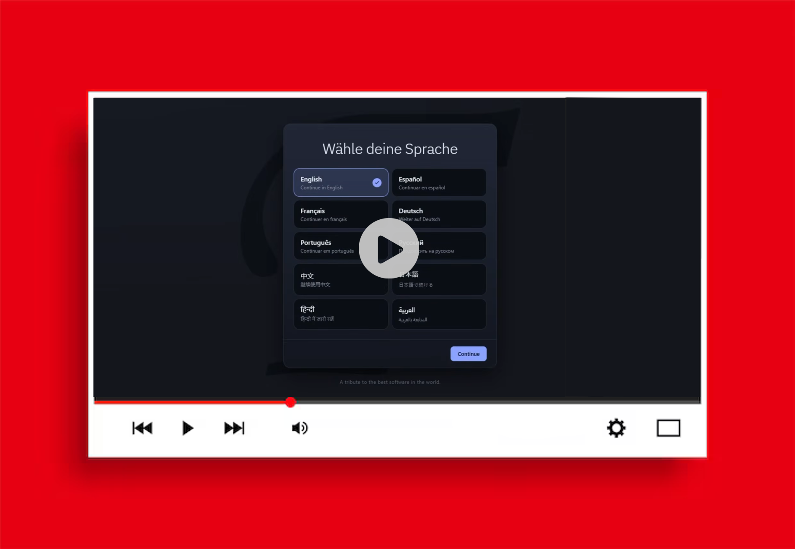
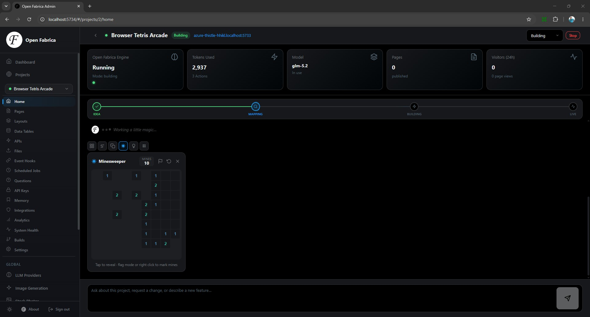
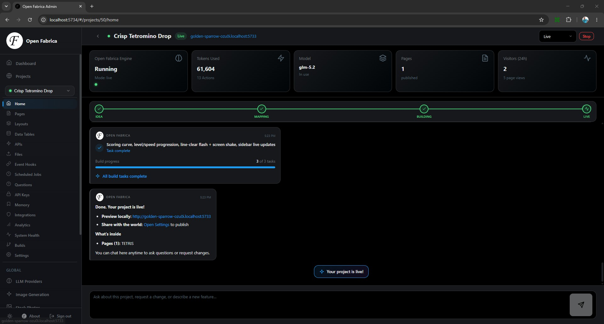
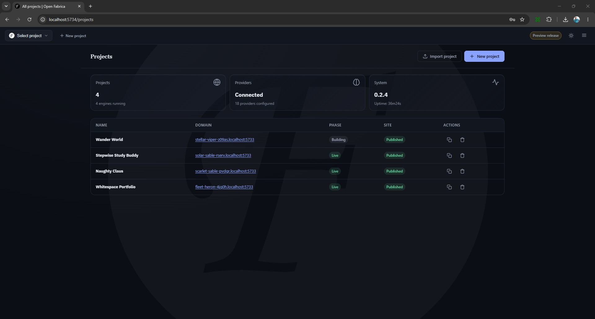
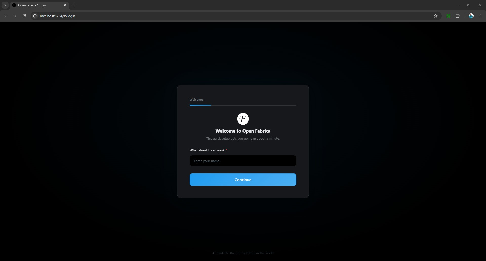
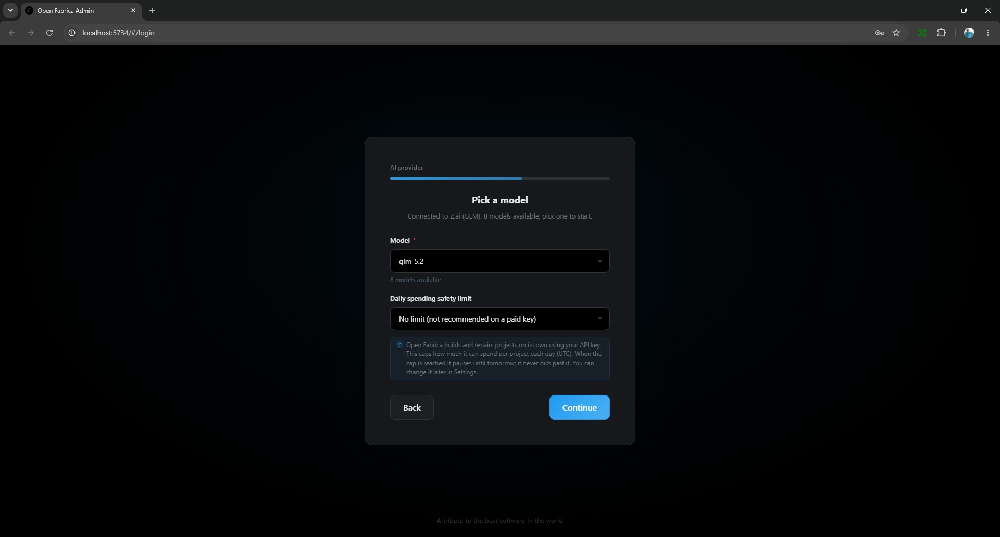

[](https://github.com/dark-rumlinger/open-fabrica/releases)
[](https://github.com/dark-rumlinger/open-fabrica/releases)
[](https://github.com/dark-rumlinger/open-fabrica/releases)
[](https://github.com/dark-rumlinger/open-fabrica/releases)
[](https://github.com/dark-rumlinger/open-fabrica/releases)


Just imagine a wild party where webservers, coding agents, database engines, reducers and many more entities get an omnipotent baby together which is well trained, super easy to handle and doesn't cry. It's a complete ecosystem in a single file.

In fact, it is the most user friendly software in the observable universe. In literally one click you go from an idea to a product, reachable by anyone in the world. Zero config needed, no matter the complexity.


## Great Ideas are Everywhere

It's meant for everyone. Literally. From school kids to teachers and from scientists to managers.

Everyone has ideas and now there is no technical mountain to climb anymore. 

So get your cheap coding plan or run a local model and start changing the world.

## What Can it Create?

ANYTHING which runs in a browser, just using one (!) click.

- LLM-powered tools (chatbots, automated customer support, code generators etc.)
- File sharing platforms
- Apps for shops and businesses (like a coffee order board)
- Web(apps/sites) (duh!)
- 2D/3D multiplayer games
- (Encrypted) communication apps
- Realtime collaboration tools

We're certain you'll come up with the most amazing stuff yourself.

## Free, Private and Portable

- **Forever Free.** No sign-up, no subscription, no per-project fee. Download the binary and run it.
- **No phone-home.** No usage or error reporting, no analytics SDK, no "check for updates" call. The admin panel is fully self-contained (every script, style, and font is served from the binary), so it works fully offline.
- **Local First.** One binary, your data, your machine. The only time anything leaves your computer is when *you* trigger it.
- **Bring your own key.** Use your own Anthropic, OpenAI, Google Gemini, OpenRouter, or Z.ai key, or run fully offline models with Ollama or llama.cpp.
- **Portable.** Copy the binary and your `data/` folder to any Windows, macOS, or Linux box and it picks up where it left off, or use `openfabrica backup` / `openfabrica restore` for a single-file backup that works while the server runs. To remove an installation completely, send `/selfdestruct` to the Telegram bot (two confirmations); `openfabrica selfdestruct --dry-run` previews what it would erase. See [SECURITY.md](docs/SECURITY.md) for its limits.


## Quick Start

**Important: This is an experimental release which focuses on getting the core build loop as stable as possible: things will break and tokens will be wasted. Ideally you're on a cheap coding plan or run a local model when your hardware allows for that. Many architectural decisions are not finalized.**

[](https://www.youtube.com/watch?v=n17afF0SnDo)

1. **Download latest binary** from [Releases](https://github.com/dark-rumlinger/open-fabrica/releases).
2. **Run it.** Double-click the file, or run `./openfabrica` in your terminal.
3. **Open** `http://localhost:5734` in your browser.
4. **Pick an AI provider.** The setup wizard lists the built-in providers (Anthropic, OpenAI, Gemini, OpenRouter, Z.ai, Ollama, llama.cpp, plus a few subscription coding plans) and asks for an API key. Ollama and llama.cpp need no key, so a local model works as soon as it is running. Any other OpenAI-compatible endpoint can be added later from the AI Providers page.
5. **Describe your idea.** Open Fabrica takes it from there.

## Features

- **Fully self-contained** binary which runs everywhere.
- **Instantly live** by eliminating the concept of hosting.
- **Unlimited projects** from a single instance.
- **Accounts and logins** with optional Google/GitHub social login (any OAuth2 provider works), TOTP 2FA, and passwordless magic links.
- **Payments** via Stripe, PayPal, or Mollie; one-off on all three, recurring on Stripe. Stripe reconciles itself from signed webhooks; PayPal and Mollie payments are reconciled manually.
- **Email** (SendGrid, Mailgun, Resend, or any JSON endpoint).
- **Web Push** with auto-managed VAPID keys, plus an in-app notification inbox (list, unread count, mark read) served to each signed-in user.
- **Real-time** chat rooms, live feeds, P2P calling, and file uploads, with optional end-to-end encryption.
- **Image generation** via OpenAI or a local Stable Diffusion (Automatic1111) instance.
- **Stock photos** from Pexels, Pixabay, and Unsplash, picked automatically.
- **PDF generation** for invoices, receipts, tickets, and reports: one-off documents rendered while building, or an endpoint that fills an HTML template from each request's data and returns the PDF (needs a local Chromium based browser).
- **CSV import/export**, **RSS/Atom feeds** served straight from a table.
- **Keyword search** out of the box, and **semantic search** once an embeddings provider is configured (the seeded OpenAI provider has one).
- **Analytics** (visits, unique visitors, top pages, referrers, AI usage/cost), all stored locally.
- **SEO** (Open Graph, Twitter cards, JSON-LD, sitemaps, robots.txt) handled automatically.
- **Native PWA support** for offline and installable apps.
- **Auto-generated APIs** with rate limiting and docs.
- **Per-project AI assistants** with configurable personality and memory.
- **AI agents** that plan and act over multiple steps: a hosted endpoint that reasons, calls your app's own functions and reads its data in a loop, and can spawn and manage sub-agents to break down bigger jobs. Stream progress live or run in the background, each bounded by a per-endpoint daily token budget.
- **Server-side AI hooks** to auto-summarize, classify, or embed new rows on insert.
- **Telegram bot** so you can plan/build projects, answer the builder's questions, watch a live progress card and browse every LLM call from your phone. Set up in two minutes with a QR code, no user IDs to look up.
- **Scheduled jobs** (cron or intervals) that run SQL, send emails, hit HTTP endpoints, or invoke the AI.
- **Event-driven actions** reacting to signups, logins, payments, and data changes.
- **Roles and permissions**: named roles with a wildcard permission catalogue; endpoints are gated by role name (`admin` passes every gate).
- **Copy and share projects**: duplicate a project in one click, or export it as a `.of` file and import it into another instance.
- **Free HTTPS** automatically, no manual actions needed.

## Screenshots












## Before You Go Live

If you only run locally, the Quick Start is all you need. If you expose generated apps to the internet or enable payments, do these first:

- **Back up your encryption key with your data.** `data/.security/encryption.key` decrypts every stored secret (API keys, OAuth tokens, payment credentials, TOTP seeds). Lose it and those are unrecoverable. Back it up *together with* the `data/` folder, kept somewhere the data backup alone can't leak it.
- **Set a spend ceiling.** Unattended AI, the build/self-repair loop **plus** event triggers, scheduled jobs, and server functions, calls the LLM on your key. A safe ~1M-token-per-project-per-day ceiling ships **on by default** and is a single shared pool across all of those paths (change it in the wizard or **Settings → Daily AI spend limit**, or set `OPENFABRICA_ENGINE_DAILY_TOKEN_BUDGET=0` for unlimited). When a project hits the ceiling those calls pause instead of billing all night. The AI chat and agent endpoints your app's visitors call draw on a **separate** pool (1M tokens per project per day by default), so a busy public chatbot cannot pause your builds. Each project can set its own token limit for both pools and one **dollar cap** over everything (**Project → Settings → Advanced → Daily AI limits**), priced from each model's recorded prices.
- **Isolate untrusted/multi-user apps.** The public CSP is permissive by design. Serve each project on its **own domain/subdomain** so one app can't reach another's same-origin storage, and tighten the CSP instance-wide via `OPENFABRICA_PUBLIC_CSP` or per project in **Project → Settings → Advanced**.
- **Cap memory for untrusted apps.** Model-authored server functions run in a JS sandbox that limits CPU and output but **not heap**, so a runaway handler can exhaust memory and crash the whole instance. Set a soft ceiling with `OPENFABRICA_MEMORY_LIMIT` (e.g. `1GiB`) so GC pushes back before the process climbs into the OS OOM-killer, and for a hard backstop run under an OS/container memory limit with auto-restart. The shipped [`Dockerfile`](Dockerfile) wires `--memory` + `GOMEMLIMIT` for you; on bare metal use systemd `MemoryMax=`/`Restart=` or a cgroup. This is a floor, not tenant isolation. See [Security](docs/SECURITY.md).
- **Keep the admin panel on localhost** (the default). See **Security** below.

Health probes on either port (both bypass auth and routing): `GET /health` (alias `/healthz`) is a **liveness** check that always returns `{"status":"ok"}` while the process can answer requests. `GET /ready` (alias `/readyz`) is a **readiness** check that pings the database and returns `{"status":"ready"}` (200) when it can serve, or `{"status":"unavailable"}` (503) when the database is unreachable, point your load balancer or orchestrator at `/ready`.

## Self-Hosting and HTTPS

Point your domain's DNS at your server, open ports 80 and 443, then add the domain to a project (Project → Settings → General → Domain). HTTPS goes live on demand: Open Fabrica binds :80/:443 and Let's Encrypt issues the certificate within ~30 seconds, no restart. If another web server already owns those ports, set `"tls_disabled": true` in config.json (or `OPENFABRICA_TLS_DISABLED=1`) to skip the bind.

When you set a public domain, the admin UI walks you through whatever is left, with one click wherever a machine can do it:

- **Allow through firewall** (Project → Settings → General) if the local OS firewall is blocking inbound. It adds the allow-rule after a single system prompt (UAC on Windows, the administrator prompt on macOS, polkit on Linux).
- **Open ports on my router** if your router supports automatic port forwarding (UPnP, NAT-PMP, or PCP, which most home routers do). Only ports 80 and 443 are forwarded, only while Open Fabrica runs, and you can stop it any time from Project → Settings → General. Routers that refuse get step-by-step manual instructions instead.
- **The DNS record to add**, with this machine's public IP filled in. The IP comes from your router over the local network, never from an outside "what is my IP" service.

It also tells you when port forwarding cannot work at all: if your internet provider shares one address across many customers (carrier-grade NAT), it says so and points to IPv6 or asking the provider for a public IPv4. And if your home connection gets a new IP later, the admin UI flags that the domain's A record needs updating.

## Security

The admin panel runs on port **5734** and binds to **localhost only** (`127.0.0.1`) by default. It can read every project's data and decrypt stored secrets, so it is treated as a local control plane, not a public surface. To reach it on a remote server, use an SSH tunnel:

```bash
ssh -L 5734:localhost:5734 user@yourserver
```

If you genuinely need it reachable over the network (behind your own firewall or authenticating reverse proxy), set both `OPENFABRICA_ADMIN_BIND` to the interface (e.g. `0.0.0.0`) **and** `OPENFABRICA_ADMIN_EXPOSE=1` to acknowledge the exposure, or the server refuses to start. An exposed instance with no admin account yet prints a one-time `setup_token` to its console, and the first-run wizard asks for it, so nobody who finds the open port can claim the box before you. The public project server on port **5733** is always network-reachable.

Admin login is protected by a per-IP rate limit and a per-account lockout (five wrong passwords locks the account with escalating backoff). Changing or resetting a password immediately invalidates every existing session for that user.

## Configuration

Zero-config by default. To tweak, use `config.json` or environment variables.

| Variable | Default | What it does |
|---|---|---|
| `OPENFABRICA_ADMIN_PORT` | 5734 | Port for the admin panel |
| `OPENFABRICA_ADMIN_BIND` | 127.0.0.1 | Interface the admin panel binds to (loopback by default) |
| `OPENFABRICA_ADMIN_EXPOSE` |  | Set to `1` to allow binding admin to a non-loopback address (required alongside a routable bind) |
| `OPENFABRICA_PUBLIC_PORT` | 5733 | Port where your project is served |
| `OPENFABRICA_DATA_DIR` | ./data | Where project data is stored |
| `OPENFABRICA_DB_PATH` | `<data_dir>/openfabrica.db` | Path to the core SQLite database |
| `OPENFABRICA_SEED_PATH` | ./seed.json | Provider seed applied on every start; the copy built into the binary is used when the file is missing |
| `OPENFABRICA_JWT_SECRET` | auto-generated | JWT signing key (min 32 chars) |
| `OPENFABRICA_ENCRYPTION_KEY` | auto-generated | At-rest encryption key (64 hex chars) |
| `OPENFABRICA_ALLOW_KEY_REGEN` |  | Set to `1` to permit generating a **new** `jwt.key`/`encryption.key` when the file is missing but a database already exists. Off by default: a missing key on a populated data dir makes the server **refuse to start** rather than silently mint a new one. Regenerating **invalidates every session** (JWT key) and makes previously-encrypted secrets - provider keys, OAuth/payment tokens, TOTP seeds - **permanently unreadable** (encryption key). Set it only if you have no key backup and accept that loss. |
| `OPENFABRICA_TLS_DISABLED` | false | Skip binding :80/:443 (use when another web server owns those ports) |
| `OPENFABRICA_TLS_STAGING` | false | Use Let's Encrypt's staging CA (avoids the production rate limit while iterating) |
| `OPENFABRICA_LOG_LEVEL` | info | `debug`, `info`, `warn`, `error` |
| `OPENFABRICA_LOG_FILE` |  | Also write the log to this file (relative paths are inside the data directory), rotated at 20 MB with five old files kept |
| `OPENFABRICA_MEMORY_LIMIT` |  | Soft heap ceiling (e.g. `1GiB`, `512MiB`, or raw bytes; `0` disables). Applied via Go's soft memory limit so GC pushes back before the process is OOM-killed. When unset, a `GOMEMLIMIT` in the environment is still honored. Not tenant isolation: pair it with a container/OS hard limit + auto-restart for untrusted apps. |
| `OPENFABRICA_TRUSTED_PROXIES` |  | Comma-separated IPs/CIDRs of reverse proxies in front of the public server (loopback is always trusted), so rate limits and IP bans see the real visitor |
| `OPENFABRICA_RATE_LIMIT_RATE` | 100 | Requests per second per IP |
| `OPENFABRICA_RATE_LIMIT_BURST` | 200 | Burst allowance above the rate |
| `OPENFABRICA_LLM_TIMEOUT` | 900 | Per-LLM-call deadline in seconds |
| `OPENFABRICA_ENGINE_DAILY_TOKEN_BUDGET` | 5000000 | Max cost-weighted engine tokens per project per UTC day. The build/self-repair loop pauses when reached. Set `0` for unlimited. Resolution order: env var > admin/setup setting > config.json > default (applies live). |
| `OPENFABRICA_ENGINE_STAGE_EXPAND_TIMEOUT_MIN` | 5 | Wall-clock timeout (minutes) for the EXPAND stage. Overrides the built-in default; raise it when a slow provider makes a legitimate build exceed it, instead of rebuilding the binary. |
| `OPENFABRICA_ENGINE_STAGE_PLAN_TIMEOUT_MIN` | 30 | Wall-clock timeout (minutes) for the PLAN stage. |
| `OPENFABRICA_ENGINE_STAGE_BUILD_TIMEOUT_MIN` | 90 | Wall-clock timeout (minutes) for the BUILD stage. |
| `OPENFABRICA_PUBLIC_CSP` | (permissive) | Override the CSP on public project pages. The permissive default carries `'wasm-unsafe-eval'` so WebAssembly modules (TensorFlow.js, MediaPipe, ffmpeg.wasm, game engines) compile - the browser gates WASM behind CSP, and this keyword permits only WASM compilation, not JavaScript `eval()`. Put the literal `{nonce}` token in a `script-src` and the server mints a per-request nonce so inline scripts work without `'unsafe-inline'`. Or set it to the keyword `hardened` for a built-in strict preset (scripts locked to `'self'` + nonce + `'wasm-unsafe-eval'`; external images, fonts, and styles still load). Also settable per project. Empty string removes the header. |
| `OPENFABRICA_NO_BROWSER` |  | Set to `1` or `true` to suppress auto-opening the admin URL on startup. |
| `OPENFABRICA_OLLAMA_KEEP_ALIVE` | 30m | How long Ollama keeps a model (and its prefix cache) resident between calls. `-1` keeps it resident, `0` unloads after each call. |
| `OPENFABRICA_OLLAMA_NUM_CTX` |  | Ollama context window for build calls. Set it at least as large as the build prompt (~16k+ tokens) so the cached prefix isn't evicted. |

A few knobs are set only in `config.json` (no env-var override). `cors_origins` is a JSON array of origins allowed to call the public project APIs cross-origin; when omitted it defaults to permissive (`*`, credentials withheld) - set it to your app's origins if you serve untrusted or multi-user apps.

When using Ollama, run the daemon with `OLLAMA_NUM_PARALLEL=1` for best prefix-cache reuse. Stock-photo providers (Pexels, Unsplash, Pixabay) are optional: configure them from the admin UI or seed a key via `PEXELS_KEY`, `UNSPLASH_KEY`, and `PIXABAY_KEY`.

## Build from Source

Requires **Go 1.26+**. No C compiler needed, the SQLite driver is pure Go.

```bash
git clone https://github.com/dark-rumlinger/open-fabrica.git
cd open-fabrica
make dev        # run directly, or: go run ./cmd/openfabrica
make build      # stripped, version-stamped binary in ./bin
```

Before opening a pull request, run the local quality gates with `make check`
(gofmt + vet + build + tests). See [CONTRIBUTING.md](docs/CONTRIBUTING.md) for the
full developer guide and [CONVENTIONS.md](docs/CONVENTIONS.md) for house rules.

To see what a build actually did, and what it cost, read [TRIAGE.md](docs/TRIAGE.md).

## Architecture

Open Fabrica runs a per-project background worker, the **engine** (`engine/`), which walks each project through a stage pipeline:

```
EXPAND → PLAN → BUILD → LIVE
                  |
                  +--- (validators + click-through; findings drive a bounded repair)
```

Each stage is a registered `Stage` carrying its own timeout and start line; `defaultPipeline` (`engine/stage.go`) is the one place the order lives, so a stage hands off with `Outcome{Advance: true}`. EXPAND sharpens a sparse brief; PLAN seeds a build checklist; BUILD works through it in one continuous, prompt-cached session, then runs the validators (a headless-Chrome runtime probe plus websockets smoke tests). It then clicks every control on every page and checks the phone layout. Fixable findings reopen the build for up to two short repair rounds; anything left ships as known issues the owner and the live agent both see, then the project goes LIVE. A chat message to a live project is handled directly by the live agent; an explicit update request re-enters at PLAN, and BUILD rebuilds only what actually changed.

Every stage runs through one unified session loop (`engine/session.go`): an append-only, byte-stable transcript so provider prompt caches hit across iterations, plus a content-addressed replay cache (`of_llm_cache`) that makes crash resume and retries nearly free. Context overflow ends the segment and reseeds deterministically from database state, the same mechanism that powers crash recovery.

All LLM-facing guidance lives in one **knowledge** tree (`knowledge/`): an always-on `mental-model.md`, recall-on-demand capability guides, canonical contracts, and per-stage frames + fragments. The `pack` package selects and renders them into each stage's byte-stable system prompt. Load-bearing **facts** (REST envelope, `auth_token` key, E2EE wire envelope, realtime frames, trigger events, payment flow) are defined once in `contracts/` and transcluded via `{{contract:<id>}}`, so a copy can't silently drift; a consistency test fails the build if it does. Tools live under `tools/`, each registering a declarative `tools.Tool`; every caller (build loop, live chat, jobs, triggers) runs them through one `tools.Executor.Invoke` path with a shared `tools.Env`, and tool tests use `tools/tooltest` against the real migrated schema. `engine/testdata/golden` pins the exact bytes of every stage's prompt, so a refactor that would silently re-bill the provider cache fails the build (`go test ./engine -run TestGoldenPromptBytes -update` after an intended prompt change). Guard tests (`TestNoCrossPackDuplication`, `TestGovernedDocsMatchContracts`, the `*_drift` tests) fail the build on a drifted copy.

## License
Open Fabrica is released under the [MIT License](LICENSE). Third-party components keep their own licenses, listed in [THIRD_PARTY_LICENSES](THIRD_PARTY_LICENSES).

## Acknowledgements

Open Fabrica stands on a lot of excellent open-source work. Special thanks to [Let's Encrypt](https://letsencrypt.org) for free HTTPS, and to the libraries it's built on:

- **[modernc.org/sqlite](https://gitlab.com/cznic/sqlite)**: a pure-Go SQLite, and the reason the whole app ships as one binary with no cgo and cross-compiles anywhere.
- **[goja](https://github.com/dop251/goja)**: the embedded JavaScript engine that runs model-authored server functions and multiplayer game logic in a sandbox.
- **[esbuild](https://github.com/evanw/esbuild)**: parses and statically analyses the JavaScript the model writes.
- **[chromedp](https://github.com/chromedp/chromedp)** + **[cdproto](https://github.com/chromedp/cdproto)**: headless-Chrome automation for the runtime validator and PDF generation.
- **[certmagic](https://github.com/caddyserver/certmagic)**: automatic Let's Encrypt issuance and on-demand TLS.
- **[chi](https://github.com/go-chi/chi)**: HTTP routing.
- **[coder/websocket](https://github.com/coder/websocket)**: WebSockets for realtime rooms, feeds, and calls.
- **[golang-jwt](https://github.com/golang-jwt/jwt)**: JSON Web Tokens for end-user auth.
- **[ledongthuc/pdf](https://github.com/ledongthuc/pdf)**: PDF text extraction.

Plus [google/uuid](https://github.com/google/uuid), [zap](https://github.com/uber-go/zap), and the Go team's [`golang.org/x`](https://pkg.go.dev/golang.org/x) `crypto`, `net`, and `text` packages.


## Meet the 'Team'

Hi I'm Mark.

Be nice to others. It makes the world a much nicer place to live in!

If you need me I'm on X ([@open_fabrica](https://x.com/open_fabrica))


## A personal Note

I don't do hype, and I believe *real* talent is hard to find. A significant portion of workplace activity is self-justifying: processes and tasks that exist to preserve roles rather than produce outcomes.

The workplace fascinates me precisely because I've never figured it out. Sandboxes governed by their own rules and power dynamics, none of which ever made sense to me. But people want to belong to something. A group, a mindset, a reassurance that they're doing great things while wearing a hoodie with the company logo on it. Until a higher paying job comes along.

I think there's comfort in that, in running on autopilot. Honestly, I wish I could. It would have spared me the mental toll, and everything that followed from it: the physical, the relational, the financial. That's the cost of trying to act like a machine when you aren't one.

So if you want to take anything from this: you'd better hope you're a robot. Otherwise life will bring you to your knees while the world keeps moving. I've used the workplace as an example, but this applies to everything.

Or maybe, just maybe, it's all just me.


